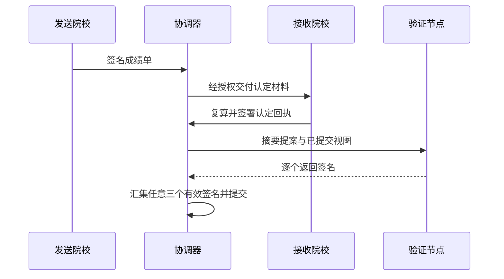

# 机构持钥与计划性轮换

安装 EduCreditLab v1.3.0 后，可以在现有研究工作台复核回执，也可以通过命令行建立独立持钥的四节点联盟。每个院校和验证节点在自己的受控设备生成并保存加密私钥。协调器登记公钥并汇集签名，验证节点各自维护投票数据库。当前流程以文件交换实现，适用于合成数据演练和机构试点前测试。

## 先复验随包案例

```bash
educreditlab custody demo --out ./custody-output
```

`custody-summary.json` 列出同一认定日与政策视图下的两次签发。在签发区块 #4 和 #7 之间，接收院校在 #5 轮换，验证节点 `peer-b` 在 #6 轮换。两份回执均包含足以复算的证据，结果均为 16 个学季学分。打开工作台的**存证与回放 → 验证导出的证明**即可核验。合成案例的信任指纹在 `trusted-manifest-sha256.txt`，正式工作中则由参与方通过独立渠道确认指纹。

## 建立持钥试验网络

1. 每个参与方在自己的设备运行 `keygen`，按提示设置私钥文件口令。下例使用合成机构身份和一个验证节点。其余验证节点分别使用 `peer-b`、`peer-c`、`peer-d`。发送院校用 `actor glendale-cc`。各方仅发送公钥登记文件。

   ```bash
   educreditlab custody keygen actor uc-irvine --key irvine.pem --enrollment irvine-public.json
   educreditlab custody keygen validator peer-a --key a.pem --enrollment a-public.json
   ```

2. 协调器初始化新的工作区。所有方核对各自的公钥、身份与网络清单指纹，经独立渠道分发并认可该指纹。命令中的 `TRUST` 请换为实际确认的 64 位十六进制 SHA-256。

   ```bash
   educreditlab --workspace ./pilot custody init glendale-public.json irvine-public.json a-public.json b-public.json c-public.json d-public.json --out genesis.json
   ```

3. 每个验证节点初始化一次自己的投票数据库。日常签名、节点重启与换钥都继续使用同一文件。备份时协同保存该节点的数据库、密钥与当前指纹。停止该节点的写操作后复制数据库，或使用 SQLite 一致性备份。恢复节点时保留已经签出的待提交投票。

   ```bash
   educreditlab custody validator-init genesis.json --validator peer-a --state a-votes.sqlite3 --trust TRUST
   ```

## 登记政策和签发回执

接收院校用自己确认过的已提交视图和待登记政策签名。首次登记使用 `genesis.json`。随后的操作使用协调器导出的最新 `head.json`，需要时可用 `custody head --out head.json` 重新导出。如果登记政策修订，同时传入 `--supersedes 父政策摘要 --reason 修订原因`。

```bash
educreditlab custody sign-policy src/educreditlab/data/uc-irvine-ay-2022-23.json --head genesis.json --key irvine.pem --trust TRUST --out policy-signed.json
educreditlab --workspace ./pilot custody submit policy-signed.json --out proposal.json
```

协调器把 `proposal.json` 发给各验证节点。每个节点使用自己的私钥和投票数据库，核验完整已提交前缀和当前提案后，发送独立签名。协调器收到三个不同节点的有效投票即可提交。下例以 `peer-a`、`peer-b`、`peer-c` 为例。

```bash
educreditlab custody vote proposal.json --validator peer-a --state a-votes.sqlite3 --key a.pem --trust TRUST --out vote-a.json
educreditlab --workspace ./pilot custody commit vote-a.json vote-b.json vote-c.json --out head.json
```

所有验证节点可用 `custody validator-sync head.json --validator … --state … --trust TRUST` 接受已经认证的视图。若协调器或文件交换中断，用 `custody pending --out proposal.json` 取回原提案，再收集缺少的投票。重复提交签名文件返回既有区块。



先生成一份合成成绩单，然后在发送院校签名。协调器用已登记政策准备审核材料，接收院校检查材料并独立计算与签名。

```bash
educreditlab case programming-calculus --out transcript.json
educreditlab custody sign-transcript transcript.json --head head.json --key glendale.pem --trust TRUST --out transcript-signed.json
educreditlab --workspace ./pilot custody prepare-receipt transcript-signed.json --receiver uc-irvine --as-of 2023-06-15 --out receipt-request.json
educreditlab custody approve-receipt receipt-request.json --key irvine.pem --trust TRUST --out receipt-signed.json
educreditlab --workspace ./pilot custody submit receipt-signed.json --out proposal.json
```

回执经同样的投票与提交步骤写入账本。`approve-receipt` 显示回执摘要，`recognized_units` 按学分的百分之一计数，`1600` 表示 16 学分。从已提交账本导出完整回执，并用同一可信指纹离线验证。确需对外仅验证存证时，加上 `bundle --anchor-only` 导出仅含摘要和签名的证明。

```bash
educreditlab --workspace ./pilot bundle RECEIPT_SHA256 --out proof.json
educreditlab verify proof.json --trust TRUST
```

成绩单、待审核材料和完整回执包含成绩证据，仅交付给获授权的参与方。验证节点收到的提案包含身份、政策和回执摘要、视图锚点及签名，没有课程成绩。认定规则的历史视图可用 `prepare-receipt --known-height` 指定，回执批准另外固定审批时的最新已提交区块。若其间产生任何新提交，重新准备与批准未提交的回执。

## 轮换与验证边界

密钥所有方用 `keygen` 为原角色和身份生成新的私钥文件，再用新旧私钥签署同一个轮换授权。使用当前的 `head.json`。轮换授权沿用相同的 `submit`、`vote` 与 `commit` 流程。

```bash
educreditlab custody keygen actor uc-irvine --key irvine-next.pem --enrollment irvine-next-public.json
educreditlab custody rotate actor uc-irvine --head head.json --trust TRUST --old-key irvine.pem --new-key irvine-next.pem --reason "Scheduled renewal" --out rotate-signed.json
```

轮换在区块 H 提交时以 H 之前的公钥状态核验。H+1 起，业务签名和投票均使用新的对应公钥。验证节点轮换用 `rotate validator peer-a`，保持原投票数据库。旧回执及其账本投票按原区块高度核验。发送院校换钥后，尚未签发回执的成绩单需用当前密钥重签。登记在链上的旧公钥为既有证据提供历史核验依据。

机构持钥模式使用已提交区块高度定位历史。提案产生时间记录在区块头，文件交换期间不推断实际提交时刻。现有的本机研究工作区可以升级软件并延续原指纹，机构持钥模式以新的公钥清单单独建网。计划性轮换要求旧私钥仍可用。试验架构采用固定验证成员与单个协调器，并依赖各节点保有自己的状态，以及参与方独立核对初始公钥和指纹。
